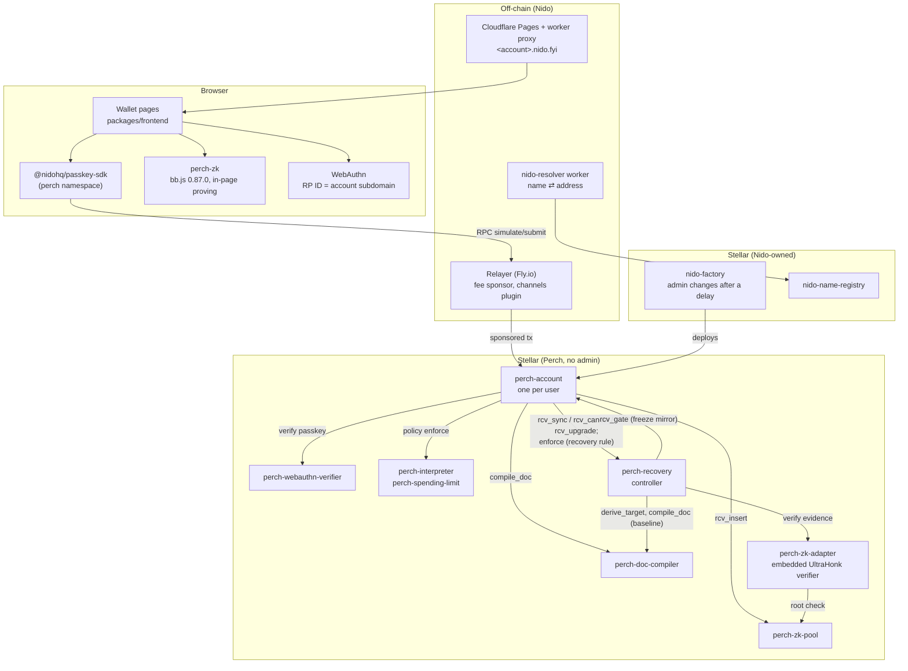
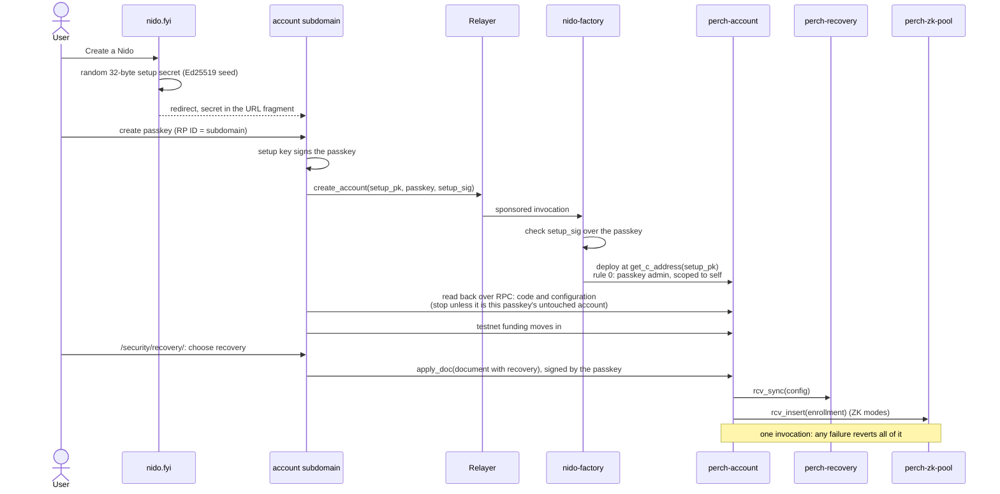
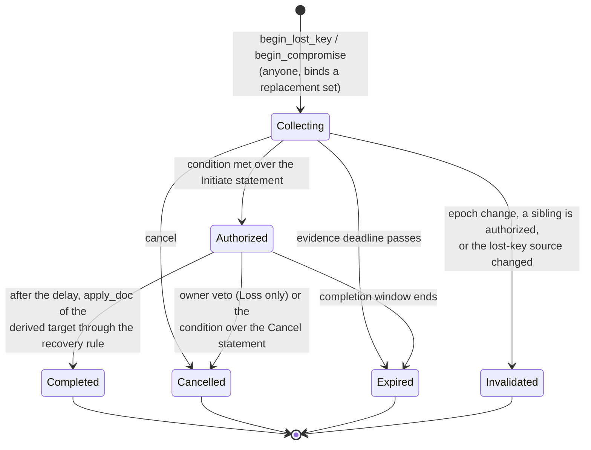

# Architecture

Nido is a passkey wallet for Stellar smart accounts. A user's account is a
Soroban contract (a `C...` address) whose signers are WebAuthn passkeys,
verified on chain. Nido's accounts are [Perch](https://github.com/stellar-registry/perch)
smart accounts: every rule, signer, and recovery setting is declared in one
policy document that the account compiles and installs through a single entry
point, `apply_doc`.

This file describes how the pieces fit. The audit package around it:

| Document | What it answers |
| --- | --- |
| [docs/AUDIT_SCOPE.md](docs/AUDIT_SCOPE.md) | What is in and out of scope, the audit manifest, the responsibility matrix, the reading order |
| [docs/THREAT_MODEL.md](docs/THREAT_MODEL.md) | Assets, adversaries, trust assumptions, and the limits of the audited behaviour |
| [docs/STRIDE_THREAT_MODEL.md](docs/STRIDE_THREAT_MODEL.md) | Each threat's STRIDE category, invariants, release gate, and status |
| [docs/SECURITY_INVARIANTS.md](docs/SECURITY_INVARIANTS.md) | Properties that must hold, each with its implementation and evidence |
| [docs/SUPPLY_CHAIN.md](docs/SUPPLY_CHAIN.md) | Every third-party input and how it is pinned |
| [docs/RUNBOOKS.md](docs/RUNBOOKS.md) | Build, deploy, operate, respond |
| [docs/MAINNET_READINESS.md](docs/MAINNET_READINESS.md) | Audit-entry and launch gates |
| [docs/DEFERRED.md](docs/DEFERRED.md) | Work outside the audit target, and the limitation each leaves |
| [DEPLOYED.md](DEPLOYED.md) | What is deployed where |

Recovery semantics are Perch's, and Perch's specification is the single
source of truth for them:
[Perch recovery spec](https://github.com/stellar-registry/perch/blob/2258433aa340428d65676cd269c8e4240674deb1/docs/recovery/spec.md)
(`vendor/perch/docs/recovery/spec.md`). This file summarizes it only as far
as Nido's integration needs; "§" and "D" numbers below are that spec's
sections and decisions.

## 1. Components



### Contracts Nido deploys

| Contract | Path | Role |
| --- | --- | --- |
| `nido-factory` | `contracts/factory/` | `create_account(setup_pk, key, setup_sig)` deploys a `perch-account` at the address `get_c_address(setup_pk)` predicts, with one constructor rule: the passkey `key` as admin, scoped to the account itself, checked by Perch's WebAuthn verifier. The address derives from a one-time setup key alone: a Nido passkey's RP ID is the account's own subdomain, so the address has to exist before the passkey (Perch's own factory, whose addresses commit to the admin signers, cannot serve this). The factory deploys only if the setup key signed `key`, so only the setup key's holder chooses the passkey at its address. If a manager is set, its authorization is required too; it decides admission, never whose account it is. The factory pins the release's account wasm hash at build time (Perch's `registry_contract!` over a pin written from Perch's deployment manifest) and deploys every account from it, and is constructed with the verifier pinned, which takes the registry off the creation path. Its admin (`admin-sep`) can upgrade the factory, repin the verifier, and set the manager, each at once and announced by an event; any delay is the admin smart account's. It has no authority over a deployed account (THREAT_MODEL 8). |
| `nido-name-registry` | `contracts/name-registry/` | Human-readable names for accounts. |
| `nido-multisig-policy`, `nido-spending-limit-policy`, `nido-preauth-sweep-policy` | `contracts/*-policy/` | OZ policies a Perch document cannot attach (the compiler attaches only Perch's interpreter and spending limit), so no account the factory mints can install them. Whether to retire or port them is an open product question (MAINNET_READINESS D6). |
| `nido-status-message` | `contracts/status-message/` | Demo contract for the example dApp. Excluded from mainnet (MAINNET_READINESS E3). |

### Contracts Nido consumes from Perch

Perch deploys these, not Nido. Perch's
[testnet manifest](https://github.com/stellar-registry/perch/blob/2258433aa340428d65676cd269c8e4240674deb1/deployments/testnet.json)
(`vendor/perch/deployments/testnet.json`) records each by wasm hash and
address; [DEPLOYED.md](DEPLOYED.md) lists them. Nido's tests run those exact
bytes, fetched by hash (see [docs/SUPPLY_CHAIN.md](docs/SUPPLY_CHAIN.md)).

| Contract | Role |
| --- | --- |
| `perch-account` | The user's account. `apply_doc(doc_json, approval_valid_until, expected_revision)` is the only way to change its rules ([Authorization](#4-authorization)): it compiles the document, checks it, synchronizes recovery with the controller, and installs the result as OZ context rules. `execute` runs ordinary calls. `schedule_upgrade` / `execute_upgrade` / `cancel_upgrade` are the seven-day upgrade path. Each apply advances the account's configuration revision and emits one `DocApplied` (the hash, the new revision, and counts of rules, signers, and policies changed; OZ's per-mutation events are silenced). With `expected_revision`, an apply prepared at another revision is refused (`StaleRevision`); every wallet apply names the revision its document was composed from (perch-js `applyDocument`, SECURITY_INVARIANTS A8). `revision()`, `configuration()`, and `document()` read the state with the revision it belongs to. A document holds at most 8 declared signers, 11 rules, and 8192 canonical bytes, with rule names of at most 20 bytes; the zero-signer recovery rule the account generates is in addition to the 11. |
| `perch-webauthn-verifier` | OZ `Verifier` for secp256r1 passkey assertions, shared by every account. Constructorless, no admin. |
| `perch-doc-compiler` | Stateless `compile_doc`: document JSON to compiled rules. The account pins its address at build time; the controller derives recovery targets through the compiler the account reports. |
| `perch-interpreter`, `perch-spending-limit` | OZ policies the compiled rules attach. |
| `perch-recovery` | The recovery controller: attempts, guardian and ZK evidence, change approvals, baselines, epochs, cancellation, completion. It is also the only policy of the account's recovery rule. Constructorless and immutable. |
| `perch-zk-pool` | Depth-32 membership pool of ZK enrollment commitments. Every historical root stays valid; a full tree rolls over. |
| `perch-zk-adapter` | Checks a proof's circuit id, root membership, and statement binding, then verifies it with the embedded UltraHonk verifier (audited, plus Perch's unaudited zero-knowledge-flavor delta, THREAT_MODEL 13). |

### Off-chain

| Component | Path | Role |
| --- | --- | --- |
| Wallet | `packages/frontend/` | Static Astro site on Cloudflare Pages. Each account lives at its own subdomain, `<contract-id>.nido.fyi`, served by the worker proxy in `frontend/worker-proxy-nido/`. All chain access is client-side. |
| Passkey SDK | `packages/passkey-sdk/` | WebAuthn parsing, Soroban auth, policy documents, and the `perch` namespace: statement encodings, recovery as document changes, controller and account clients. `@nidohq/passkey-sdk/perch-zk` proves. |
| Contract bindings | `packages/contract-bindings/` | Generated clients, including private `perch-*` clients generated from the deployed Perch wasm; Perch does not publish them ([docs/DEFERRED.md](docs/DEFERRED.md#npm-publishing-of-perch-zk-and-the-contract-clients)). |
| Relayer | `infra/relayer/` | OpenZeppelin relayer with the channels plugin. Pays fees for any contract call whose authorization is already complete. It cannot authorize anything for an existing account. It sees each setup's public key and the setup key's signature over the passkey before the account exists, which lets it withhold a setup but not claim the address (THREAT_MODEL 10). |
| Name resolver | `infra/nido-resolver/` | Serves `/.well-known/nido.json` from the name registry. Read-only. |

## 2. Subdomain isolation

The WebAuthn RP ID is the account's own hostname, so a passkey created for one
account can only sign on that account's subdomain. A guardian approves from
their own Nido's subdomain, signing through their own account. The apex origin
holds no passkey. A storage bridge (`/nido-storage-bridge/`,
`packages/frontend/src/pages/nido-storage-bridge/`) shares the
browser's account list, names, and the setup keys of accounts still being
created across the apex and account origins.

Hosts are read against a list of known apexes, never by counting labels:
`splitHost` and `NIDO_APEXES` in `packages/passkey-sdk/src/url.ts` (`test.nido.fyi`
and `nido.fyi`, longest first, plus `localhost`). An account, name or built-in
dApp is exactly one label below its apex; a PR preview adds `--<N>` to that
label, and `<N>.<apex>` is the preview root. An apex is never an account, so
`test.nido.fyi` is the testnet apex and not a name `test` on `nido.fyi`, and the
storage bridge, return-URL checks and links never cross from one apex to the
other. Names that are, or would shadow, a host (`test`, `www`, `nido`, `relay`,
the built-in dApps, preview roots) are reserved on both networks. No RP ID is
ever an apex: a credential for `nido.fyi` would be usable from every testnet and
preview origin (`packages/frontend/src/lib/rpIdInvariant.test.ts`). Wallet state
in `localStorage` that is not tied to one account address lives under
`nido:<network>:*`, so one origin serving another network later starts empty.

## 3. Onboarding



The setup secret is the seed of a one-time Ed25519 setup key. Its public key
fixes the address, and once the passkey exists the setup key signs
`sha256("nido/bind/v1" || network_id || factory_id || passkey)`; the factory
deploys only with that signature (SECURITY_INVARIANTS F6). The relayer and
anyone else who sees the setup transaction see only the public key and the
signature, so they can't bind another passkey to the address. The secret
travels in the URL fragment (as `salt`) and is scrubbed from the address bar
on load. During setup it is also kept in the browser's `nido:<network>:pending` storage
and in a `nido_setup_<account>` cookie on the site apex (30 minutes),
which sends it with requests to Nido's subdomains until the account exists;
the page drops its copies once the account is checked. Whoever holds the
secret can still bind its own passkey first, and a second `create_account`
with the same setup key fails, so that exposure is a race before the first
deploy (THREAT_MODEL 5). The wallet does not take the relayer's confirmation
as proof of what was deployed: before it activates or funds the account, it
reads it back over RPC and stops unless it is exactly what `create_account`
makes for the user's passkey (SECURITY_INVARIANTS W11). A lost race therefore
costs the user the address, not funds.

Until the first `apply_doc`, the account has only its admin rule and no
recovery. Recovery is enrolled by that `apply_doc`: the account synchronizes
the configuration with the controller and inserts the ZK leaf into the pool in
the same invocation, so there is never an account that is configured but not
enrolled, or the reverse.

## 4. Authorization

```mermaid
sequenceDiagram
    participant Host as Soroban host
    participant Account as perch-account
    participant OZ as OZ do_check_auth
    participant WV as WebAuthn verifier
    participant Policy as rule's policies<br/>(interpreter, spending limit;<br/>controller for the recovery rule)

    Host->>Account: __check_auth(payload, signatures, contexts)
    Account->>Account: refuse reserved hook names<br/>(install, uninstall, enforce, rcv_*)
    Account->>Account: Protected freeze mirror set?<br/>refuse all but the completion
    Account->>OZ: do_check_auth with the selected rules
    OZ->>WV: verify(sha256(payload ‖ rule ids), key, assertion)
    OZ->>Policy: enforce(context)
    OZ-->>Host: ok / error
```

`__check_auth`'s own two checks read only the account's storage: the
reserved-name guard (§15, D12) and the `Protected` freeze mirror (§9). The
controller sets and clears the mirror through the account's invoker-only
`rcv_gate` hook, so the freeze never needs a cross-contract read, which the
host would refuse whenever this account approves, as a guardian, at its own
controller (re-entry, D16). OZ's `do_check_auth` runs beneath `__check_auth`
and does call other contracts: each signer's verifier (`verify`) and each
policy of the selected rule (`enforce`), which for the recovery rule is the
controller.

**Who can change the document.** `apply_doc` is the only write path, and it
has two authorization paths (§15, entry-point table, `apply_doc` row; the
`apply_doc` doc comment in
[`perch-smart-account/src/lib.rs`](https://github.com/stellar-registry/perch/blob/2258433aa340428d65676cd269c8e4240674deb1/crates/perch-smart-account/src/lib.rs)
(`vendor/perch/crates/perch-smart-account/src/lib.rs`)):

- **Owner authorization**: any ordinary rule scoped to the account, in
  practice the passkey admin rule. On an account with an adopted controller,
  the controller's `rcv_sync` classifies every apply before any rule changes
  and refuses what the profile does not allow: a `Protected` reconfiguration
  without the condition's recorded approval, and any change while an attempt
  is authorized ([section 6](#6-changing-recovery-and-upgrades)).
- **The zero-signer recovery rule**, for one thing only: completing the
  authorized attempt by applying the target the controller derived. The
  controller's `enforce` requires an `apply_doc` context on this account, a
  live authorized attempt past its delay, and `sha256(target_bytes)` equal to
  the attempt's; `rcv_sync` then requires the compiled document's identity
  to equal the attempt's target hash (§6.3, T5).

**Revision binding.** Only `apply_doc` can be bound to a configuration
revision (`expected_revision`). An ordinary transaction's signature binds the
invocation and the selected rule ids, not a revision: one signed before its
rule was removed or replaced fails closed (`ContextRuleNotFound`), and one
whose rule was edited in place runs under the rule as it is at inclusion
(THREAT_MODEL L4).

## 5. Recovery

Each account chooses a profile and a mode:

| | GuardianOnly | ZkOnly | Combined |
| --- | --- | --- | --- |
| **Loss** (the passkey may be lost, not stolen) | guardian quorum | proof from the recovery kit | both |
| **Protected** (the passkey may be stolen) | same, and the condition also gates reconfiguration, upgrades, and the authorized window | same | same |

A recovery attempt:



- Evidence binds one `RecoveryStatement`: the network, account, controller,
  epoch and configuration hash, timing, and the subject (for an attempt, its
  id, the source and target document hashes, and the replacement-set hash).
  The controller builds it from its own state. Guardians authorize its digest
  from their own accounts; the circuit binds it through its `statement_hash`
  public input
  ([Perch statement encoding](https://github.com/stellar-registry/perch/blob/2258433aa340428d65676cd269c8e4240674deb1/docs/recovery/statement.md)
  (`vendor/perch/docs/recovery/statement.md`)).
- The target document is derived on chain from the source document (for a
  compromise, the enrolled baseline) and the replacement set. Nobody supplies
  a target hash. Completion is the account's `apply_doc` of that target
  through the recovery rule ([Authorization](#4-authorization)), and it bumps the epoch, revokes the
  replaced and removed credentials, spends the ZK nullifier, and inserts the
  rotated ZK credential the replacement set declares.
- Under `Protected`, an authorized attempt freezes the account: nothing but
  that completion is authorized. The freeze stops new authorizations only;
  allowances the account granted earlier stay usable (THREAT_MODEL L2).
  Under `Loss`, ordinary activity continues and the owner can veto.
- Compromise recovery needs an enrolled baseline, which is optional
  (THREAT_MODEL L1).

Wallet pages:

| Page | Code | Does |
| --- | --- | --- |
| `/security/recovery/` | `lib/recovery/settingsPage.ts` | Set, change, or turn off recovery; optionally enroll a baseline; create a recovery kit; collect a Protected account's condition for the change; owner veto. |
| `/security/recover/` | `lib/recovery/recoverPage.ts` | From a new device: new passkey, open an attempt, share guardian links, prove with the kit, finish. |
| `/security/guardian/` | `lib/recovery/guardianPage.ts` | A guardian approves an attempt, its cancellation, or a change from their own Nido or a G wallet. The page checks the request against the chain and offers no Approve button when it doesn't match. |
| `/account/policy/` | `lib/policy/docPolicyFetch.ts`, `lib/recovery/upgradesPanel.ts` | Read the applied document; schedule, execute, or cancel an upgrade. |

## 6. Changing recovery, and upgrades

- `Loss`: the owner changes recovery with an ordinary `apply_doc`.
- `Protected`: the enrolled condition first records its approval of a
  `Reconfigure` statement that binds the new configuration hash; the owner's
  `apply_doc` then consumes it, with `approval_valid_until` naming the
  statement. Rotating a passkey is not a reconfiguration.
- While an attempt is authorized, both profiles refuse every `apply_doc`
  except that attempt's completion (D3).
- Upgrades: the owner schedules a Wasm hash; it can run after 120,960 ledgers
  (about seven days). `Protected` accounts also need the condition over an
  `Upgrade` statement. A recovery-configuration change makes a queued upgrade
  stale (`StaleUpgrade`), a completion drops it, and an authorized attempt
  blocks both scheduling and execution.

## 7. Where the rules are tested

`crates/integration-tests/tests/it/` runs the production account, factory,
recovery, pool, adapter, and verifier from wasm under enforcing authorization,
with P-256 passkeys signing what a browser signs and real UltraHonk proofs of
Perch's release circuit. Two native-contract exceptions: `Target`, a
test-harness contract standing in for a capability's callee, and a failing-pool
stub (O2). The retained pre-Perch policy suites (`multisig_recovery.rs`,
`spending_limit_policy.rs`, `preauth_sweep_policy.rs`, `scoped_session_key.rs`)
are Mocked (`mock_all_auths`), testing pre-Perch mechanics only, not enforcing. See
[docs/SECURITY_INVARIANTS.md](docs/SECURITY_INVARIANTS.md) for the map from
property to implementation and evidence.
