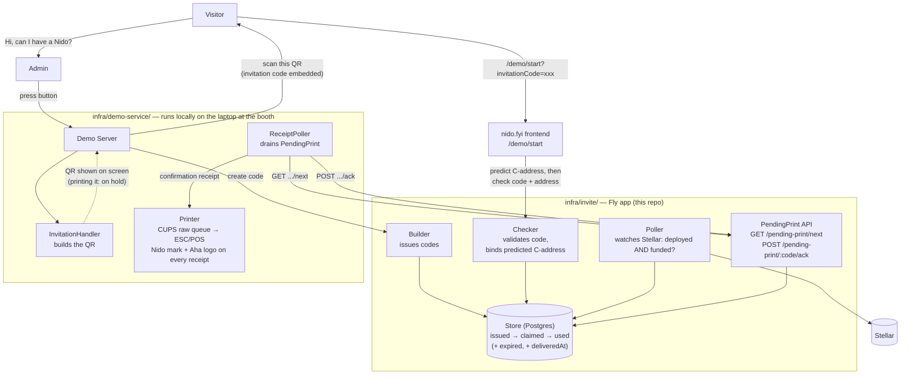

Invitation-code printing (`InvitationHandler → Printer`) is wired but paused —
the QR still shows on the Demo Server's own screen, so the flow works without
it. The confirmation receipt (`ReceiptPoller → Printer`) is the one in active
use; see `infra/demo-service/README.md`'s "Printer" section for the ESC/POS
hardware driver (CUPS, not raw USB — macOS won't allow the latter reliably)
and the branding on every receipt.

## Why the Poller stays remote and Printer confirmation is pulled, not pushed

The remote `infra/invite` service can't reach into the local Demo Server's
laptop at a conference booth (no inbound route — NAT, firewalls, "not on
Fly's network" in general). So nothing here ever has the remote side
initiate a connection to the local side. Instead:

- The **Poller** (chain-watching) stays remote, next to the Postgres Store it
  already reads and writes — it's the one piece that genuinely needs Stellar
  RPC access, and the already-public, already-deployed Fly app is a better
  place for that than a laptop.
- The local **ReceiptPoller** pulls from a small dedicated API
  (`/pending-print/next` + `/pending-print/:code/ack`) instead of the local
  side polling a bulk `GET /codes` and re-deriving which ones are ready —
  `next` already returns exactly the one thing it needs to act on next, in
  order.
- Splitting "what's next" from "mark it done" into two calls means a local
  crash between them just reprints the same receipt on restart rather than
  silently dropping it — nothing durable about "what's still pending" ever
  lives only in the local process's memory, so a laptop restart can't lose a
  visitor's receipt.
- The Poller checks the account is both **deployed and funded** before
  marking a code `used` — deployment alone used to flip it, which fired the
  confirmation receipt before the (separate, async) funding step had
  finished. See `infra/invite/src/chain.ts`'s `isFunded`.
