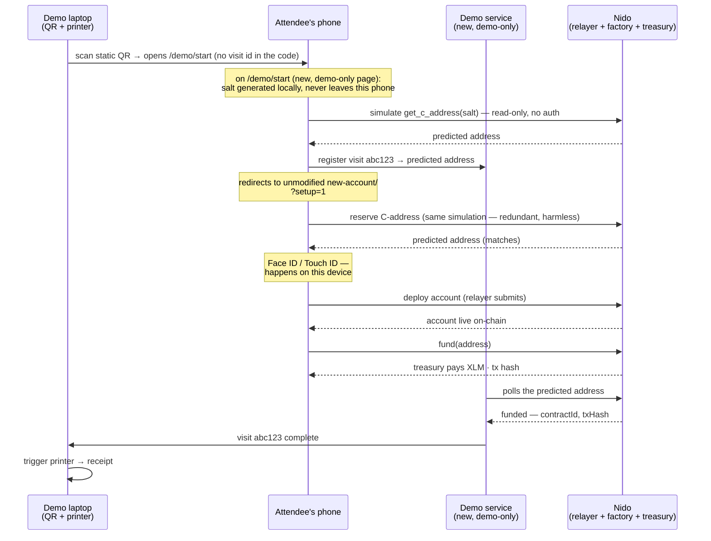
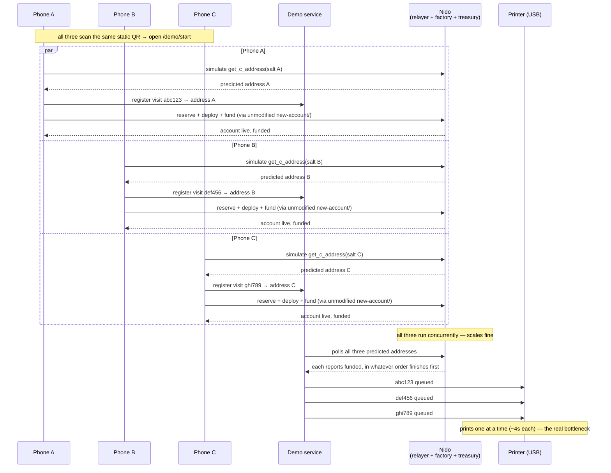

# Design: Meridian onboarding flow

## Context

A demo of Nido for Meridian: an attendee scans a QR code, is onboarded onto Nido with a funded C-address wallet on **Stellar mainnet** (real XLM, not testnet), and walks away with a physical thermal-printed receipt of the transaction. The goal is a demo that's unique and engaging but also actually demonstrates what Nido does, with the hope of showing its utility beyond "here's a wallet with some free money".

This document captures demo onboarding-flow ideas and exploration, not necessarily an implementation plan yet. See "What doesn't exist yet" for what we'd need to build, and "Connectivity ideas" for
how to handle the "conference internet connetions sucks" issue, which are parked, not yet decided.

### Contraint(s)

- The account's setup salt must be generated locally on the user's device, where the passkey ceremony is happening. It should not appear anywhere another device could read it first - this is how `createNido()` works today. 

- This means we cannot create the salt and embed it into a printed QR code. This leads to a simple static QR code that is reusable among users. The visit id each attendee ends up with (see Flow below) doesn't contradict this — it's minted on a new, demo-only page right after the scan, not baked into the printed code itself.

- The user's phone generates its own salt the moment it lands on that new page, the same way `createNido()` generates one today — just triggered by landing on a page instead of by clicking "Get started". `new-account/` itself isn't changed at all: it already knows how to handle `?setup=1#salt=<hex>` because that's exactly what `createNido()` already hands it.

- **Mainnet is a real prerequisite, not just a word swap.** `new-account/index.astro` as it stands today is hardcoded to testnet — `RPC_URL = "https://soroban-testnet.stellar.org"`, `networkPassphrase: Networks.TESTNET`, and the whole friendbot funding path (`startTestnetFunding`/`drainTestnetFunding`). None of that is environment-driven today, so "no changes to `new-account/`" above is true for the *demo-specific* logic (salt handling, visit correlation) but not for network targeting — pointing it at mainnet is itself a change, just not a demo-specific one. That's part of Nido's broader mainnet-readiness work (`docs/MAINNET_READINESS.md`), not something this doc should scope in, but it's a hard dependency: none of this runs until it's done.

- **Onboarding must only be reachable through our QR code — invite-only, not public.** This is load-bearing because it's real mainnet money: as written, `/demo/start` is just an ordinary page anyone could find (a decoded photo of the QR, the kiosk's browser history, a guessed path) and hit from anywhere, repeatedly, to drain the treasury. Friendly attendees scanning in person are a much smaller risk than the open internet — but nothing in the design currently enforces that difference. See the new "Access control" item below.

## Flow: one user at a time

The displayed QR itself is static — it just points at `/demo/start`, a new
page with no `new-account/` changes behind it:

- `/demo/start` is a real page, not a bare server redirect, because the salt
  has to be generated in a browser — nothing server-side can do that. It
  runs a little JS: generate the salt (same couple of lines as
  `createNido()`), simulate `get_c_address(salt)` to learn the predicted
  address (read-only, no auth, nothing on-chain changes), register a visit
  with the demo service against that address, then client-side redirect into
  the existing, unmodified `new-account/?setup=1#salt=<hex>`.
- The demo service doesn't wait on anything from `new-account/` — it polls
  (or subscribes to) the chain for that predicted address and declares the
  visit done once it sees the account deployed and funded. That's more
  robust than a client-reported "I'm done" ping would be, which could get
  lost on bad conference wifi (see Connectivity ideas below).
- Each `/demo/start` page load registers its own fresh visit id — nothing
  should let two attendees land on the same one.
- `new-account/` truly never finds out any of this happened. It just sees
  the same `?setup=1#salt=<hex>` shape it already handles today.

## Flow: multiple attendees at once

- Same static QR, same `/demo/start` page, for every attendee. Each phone independently predicts its own address and registers its own visit with the demo service. The demo service polls all three addresses itself, so nothing depends on `new-account/` reporting anything, no matter how many are in flight.

- Account creation and funding fan out — each phone's requests are independent, so the chain and the treasury call handle three (or thirty) at once. 

- The **one** serial step is the physical printer: receipts queue there even though nothing upstream is slow.

## What doesn't exist yet

1. **A new `/demo/start` page.** Generates the salt locally (the same couple of lines as `createNido()`), simulates `get_c_address(salt)` to learn the predicted address, registers a visit with the demo service against it, and redirects into the existing, unmodified `new-account/?setup=1#salt=<hex>`.  No changes to `new-account/` itself.
2. **The demo service.** A small service with two jobs: register a visit id against a predicted address when `/demo/start` is loaded (each one is fresh, never reused), and poll the chain for that address's deployment and funding so it can notify the kiosk once it lands — no ping from the phone or `new-account/` required.
3. **Backend-mediated funding.** Testnet onboarding funds a brand-new, self-funding keypair through the public friendbot, so no secret ever touches client code. There's no friendbot on mainnet — nothing to swap in for it. Funding has to be a server-side treasury call instead: the phone asks a funding endpoint to pay a fixed demo amount in real XLM; the treasury key never ships to the browser.
4. **Access control on `/demo/start` and the funding call.** Nothing today stops anyone who finds the URL from using it, repeatedly, from anywhere. A few cheap, layered controls — enough for "keep out randos," not "survive a nation-state":
   - A shared token in the QR's link (`/demo/start?key=<event-token>`), checked before anything happens. Not secret from attendees, but revocable: a leak just means printing a new QR with a new token.
   - Bind the funding endpoint to our/the conference's network (the dedicated hotspot/Pi from "Connectivity ideas" below) rather than the open internet — a second, independent gate, and it gives that hotspot plan a security reason to exist, not just a resilience one.
   - A hard spend ceiling on the treasury call for the whole event, independent of the above, so a worst-case leak is bounded to a known number.
   - Only live during the event's actual dates/hours.

**Proof of presence (brainstorm, not decided):** the shared token above approximates "only our QR code," but doesn't prove the *person* was there. Options, strongest first:
- **Staff prints a one-time code on the kiosk's own printer**, handed to the attendee, who scans it to start — a human verified presence before the code existed. Strongest option, but not self-serve.
- **Network-binding** (see "Connectivity ideas") — physical wifi range as the proof, fully self-serve.
- **A token on the kiosk screen that rotates every few minutes** — self-serve, closes the "shared a screenshot later" gap the static token has.
- NFC tap — looks appealing but isn't actually stronger than a QR: once tapped, the resulting URL is just as shareable afterward.

The staff-printed option reuses hardware already in the plan (no new printer needed) and bookends the experience with paper — an admission slip, then the final receipt. It needs one real change: the event-token check moves from a pure client-side string compare (`eventTokenMatches` against a fixed build-time value) to server-side, single-use state — naturally folded into the existing `POST /visits` call (send the code alongside the address; the demo service tracks issued/used codes and rejects a reused one) rather than a separate endpoint.

## Mainnet readiness: what this demo actually needs

From `docs/MAINNET_READINESS.md` — the full go/no-go bar is higher than what a
small, invited/trusted crowd needs.

**Actually blocking (demo can't work without):**
- **A3** — mainnet registry + factory deployed and wired. Without it, `fetchFactoryAddress()`/`get_c_address` has nothing to resolve on mainnet.
- Not in that doc, but found while building this: `new-account/`'s hardcoded testnet `RPC_URL`/`Networks.TESTNET` + the friendbot-only funding path both need a mainnet swap (see the mainnet constraint above).

**Worth doing given it's real money, even for friends:**
- **A4** — relayer keys off disk into KMS. One key currently sponsors/creates every account.
- **B1 (governance)** — factory admin behind a multisig, not a single deploying key.

**Not needed for this demo:**
- **A1** (ZK recovery mainnet params) — only matters if attendees set up recovery; the demo can just skip that step.
- **C/D/F** (reproducible builds, audit docs, test coverage) — audit-grade bar, not functional for a weekend demo.

A2 (setup secret off URL query params) is already mostly done and is exactly
what `/demo/start` already depends on.

## So what: beyond "free money" (brainstorm)

Receiving XLM for free doesn't demonstrate anything about *this* wallet versus any other wallet — it's the same payoff a faucet gives. The fix is to make spending it the point, not holding it.

- **Best, if feasible: pay a real vendor.** Partner with the coffee cart or merch table to accept a Nido scan-to-pay for something small. The story becomes "I scanned a QR code 30 seconds ago, had no wallet, and just paid for my coffee with it" — a demo of money moving, not a wallet sitting there. The receipt stops being a metaphor too: it's an actual receipt for an actual purchase, printed at the point of sale.
- **Fallback: a booth-owned kiosk/vending moment.** A small vending machine, raffle entry, or "mint a badge" station at the booth itself, charging a tiny real amount. Same effect — spend, not just hold — without needing a vendor partnership or anything outside our control.
- **Layer for the technical crowd: reveal the scoping.** After the basic flow, an optional follow-up screen could show that the funded wallet wasn't just a bare balance — the session key that just paid was scoped to that one vendor, up to that one amount, and couldn't have spent anywhere else. That's the one thing a self-custody wallet genuinely can't show. Worth surfacing for anyone who lingers, even if the walk-up-and-go crowd never sees it.
- **The receipt as the claim ticket.** Whatever gets redeemed above (coffee, swag, a raffle entry), the printed receipt can *be* the claim ticket — a physical punch at redemption is the anti-reuse control, no backend tracking needed for that part.

## Connectivity ideas (parked)

- **Why not venue wifi.** Conference wifi is overloaded and often sits behind a captive portal. A dedicated hotspot — independent of the venue network — for both the kiosk and the QR-joined network removes that risk entirely. It also does double duty as the access-control boundary in the new "Access control" item above — binding the funding endpoint to this network, not the open internet.
- **One QR, one action.** A single QR payload can join wifi (`WIFI:T:WPA;S:…;P:…;;`, with the OS's native join prompt as consent) *or* open a URL — not both at once.
- **The bridge: a captive portal.** Join wifi → OS auto-opens a small built-in browser to a landing page → that page's button starts onboarding.  Same pattern as hotel/airport wifi.
- **Risk: WebAuthn in that webview.** The captive-portal mini-browser is sandboxed and can misbehave with passkeys. The landing page should force "Continue in Safari/Chrome" rather than run the passkey step inline.
- **Use a Raspberry Pi.** Feasible: `hostapd` for the AP, `dnsmasq` for DHCP/DNS, `nodogsplash` for the captive portal, plus a separate uplink (ethernet or a tethered phone) so the Pi's own wifi radio is free to host the AP. Open: which Pi model, and what the uplink will be.
- **Low-tech fallback.** Two QR codes (join wifi, then open the link), or just a sign with the SSID — no captive portal, no Pi config, more friction.